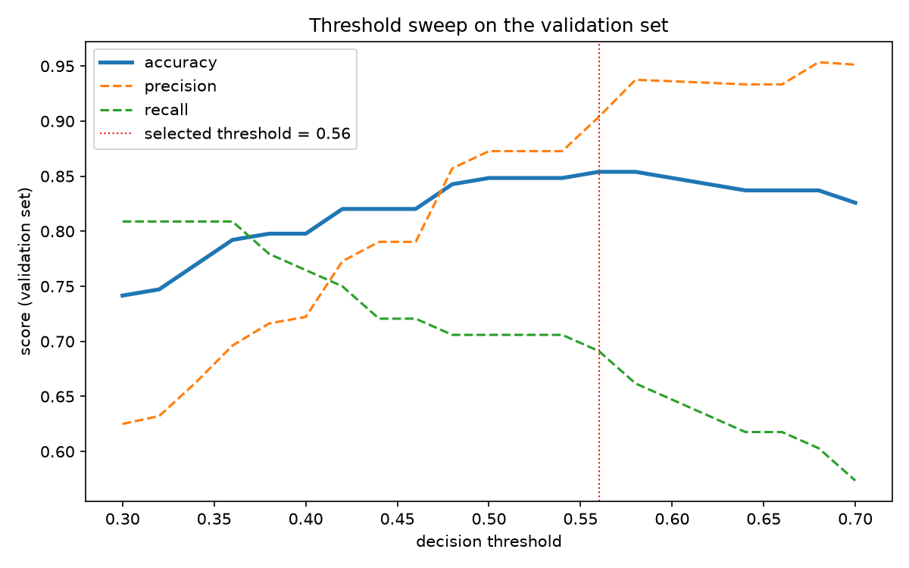
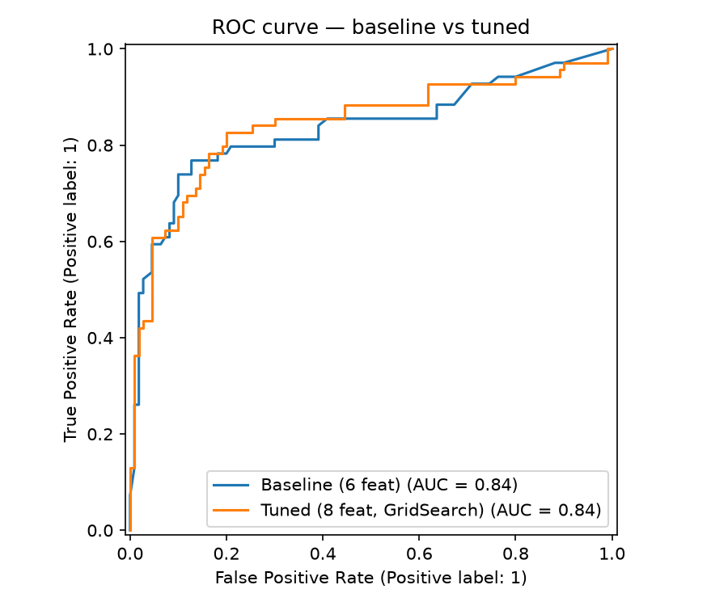
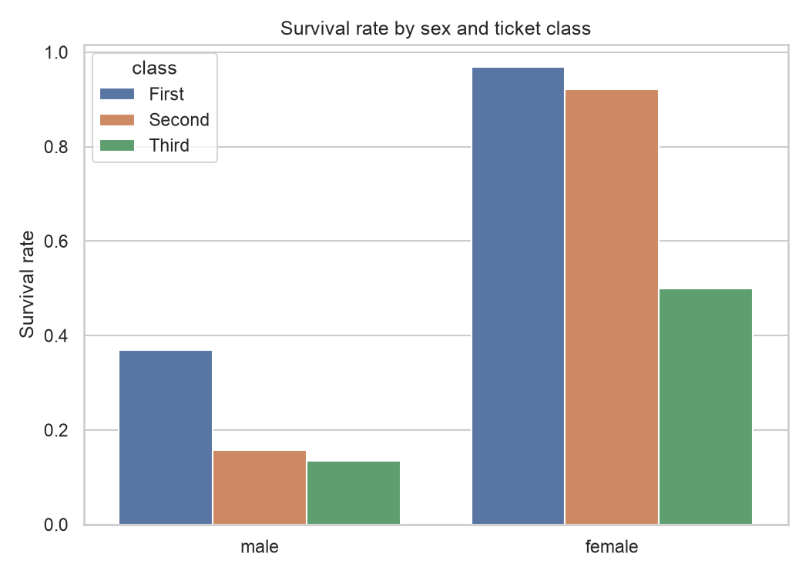
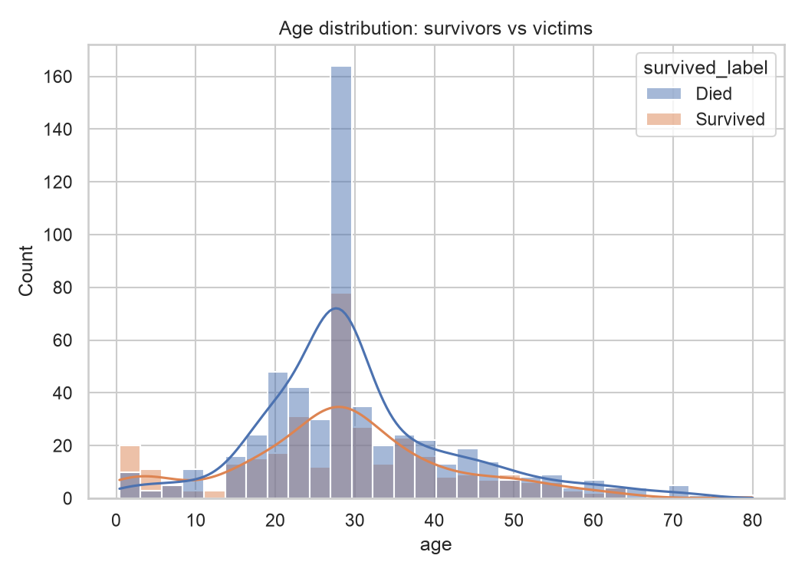
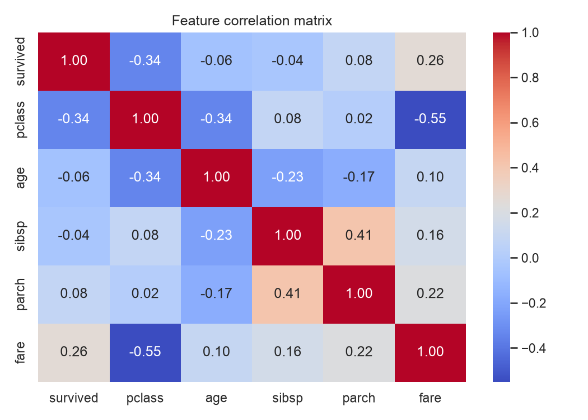
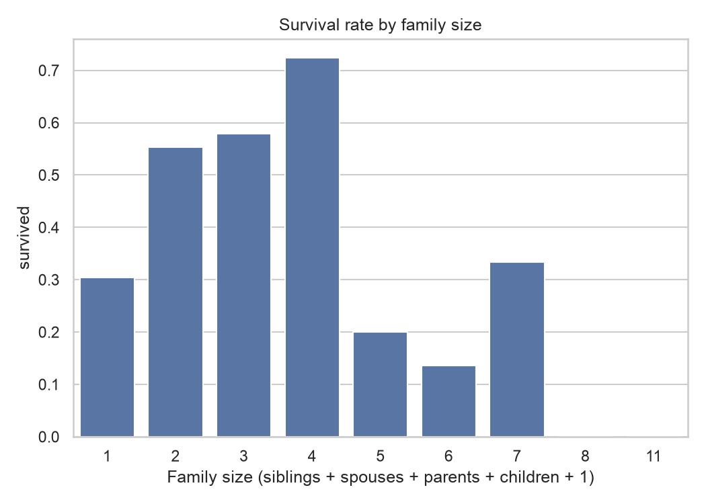

# Titanic Survival Predictor

Predict whether a Titanic passenger survived using machine learning — a complete implementation of the standard ML pipeline: Load → Clean → Visualize → Train → Evaluate → Tune.

## Results

| Stage | Model / Technique | Accuracy |
|-------|-------------------|----------|
| Phase 3 baseline | Random Forest (6 features) | 80.45% |
| Phase 5 | Random Forest (8 features) | 82.68% |
| Round 2 — CV | Tuned RF, GridSearchCV (54 candidates, 5-fold) | 82.45% |
| Round 2 — test | Tuned RF | 80.45% (AUC 0.844) |
| Round 3 — CV | Group-imputed age + deck + tuned RF | 82.21% |
| Round 3 — holdout | Production pipeline, threshold 0.56 | 78.21% (AUC 0.861) |

Models are selected by cross-validation, not by the test score: with 179 test rows, single-split differences of a couple of points fall inside the noise band (McNemar's exact test on the paired predictions, p = 0.388). ROC-AUC improved with each iteration: 0.835 → 0.844 → 0.861.



Top features by permutation importance: `sex` 0.174, `pclass` 0.068, `age` 0.036, `fare` 0.027 — the model found that women, the wealthy, and the young survived more often.



## Dataset

Uses the **Seaborn built-in Titanic dataset** (891 passengers × 15 columns) — the same data as the classic Kaggle competition, but available without a Kaggle account. Script `01` regenerates a local `train.csv` so the workflow matches the real Kaggle pipeline.

## Exploratory Data Analysis









## Project Structure

| File | Stage | What it does |
|------|-------|--------------|
| `01_load_data.py` | Load | Loads data → `train.csv`, prints `head()` + `describe()` |
| `02_clean_data.py` | Clean | Fills 177 missing ages (median), fixes missing embark ports → `train_cleaned.csv` |
| `03_train_model.py` | Train | Trains Random Forest, prints accuracy |
| `04_predict.py` | Evaluate | Confusion matrix, precision/recall, saves `my_predictions.csv` |
| `05_improve.py` | Improve | Compares 4 models, adds features, cross-validation |
| `06_visualize.py` | Visualize | 5 EDA charts → `plots/` (headless Agg backend) |
| `07_advanced_model.py` | Tune | Stratified split, Pipeline encoding, GridSearchCV, McNemar test, permutation importance |
| `08_final_model.py` | Finalize | 3-way split, group-wise imputation, threshold tuning, final holdout evaluation |
| `09_predict.py` | Deploy | Production model — predicts from CLI JSON |
| `plots/` | Output | EDA + evaluation charts |
| `requirements.txt` | Setup | Pinned library versions |

## Quickstart

```bash
git clone <your-repo-url>
cd titanic-project

python3 -m venv venv
source venv/bin/activate        # Windows: venv\Scripts\activate
pip install -r requirements.txt

python 01_load_data.py          # run in order — regenerates all data files
python 02_clean_data.py
python 03_train_model.py
python 04_predict.py
python 05_improve.py
python 06_visualize.py          # writes plots/*.png
python 07_advanced_model.py     # ~30s: grid search + significance test
python 08_final_model.py        # 3-way split, threshold tuning, holdout evaluation
python 09_predict.py            # inference demo — or pass your own passenger JSON
```

Generated CSVs (`train.csv`, `train_cleaned.csv`, `test.csv`, `my_predictions.csv`) are gitignored — the scripts recreate them deterministically (random seed fixed at `42`). The `plots/*.png` files are tracked since they render in this README.

## The ML Pipeline

```
Raw Data ──► Cleaning ──► Features (X) / Label (y) ──► Train ──► Evaluate ──► Predict
             │                    │                       │            │
             │ median imputation  │ one-hot encoding      │ stratified │ confusion matrix
             │ drop 77%-empty col │ (inside a Pipeline)   │ 80/20 split│ precision/recall
             └────────────────────┴───────────────────────┴────────────┘
                              5-Fold Cross-Validation
                                      │
              Tuning: GridSearchCV ──► McNemar significance test
                      permutation importance ──► model comparison
              Final protocol: 3-way split ──► threshold tuning ──► holdout evaluated once
                      group-wise imputation ──► production model (09)
```

## Key Techniques Used

- **Missing value imputation** — median for `age` (outlier-safe), mode for categorical
- **Group-wise imputation** — `age` filled with `median(age | sex, pclass)`, statistics fit on train only (no leakage)
- **Leakage prevention** — excluded `alive`/`who` columns (they encode the answer); encoding lives inside a `Pipeline` so test data can't shape it
- **Stratified splitting** — the 38% survival ratio is preserved in train, validation, and holdout
- **Unseen-category safety** — `OneHotEncoder(handle_unknown="ignore")` instead of `get_dummies`
- **Model comparison** — Random Forest vs. Decision Tree vs. Logistic Regression (with `StandardScaler` pipeline)
- **Hyperparameter tuning** — `GridSearchCV` (54 candidates × 5 seeded, shuffled, stratified folds) on the training set only
- **Cross-validation** — 5-fold CV for model selection; the test set is not used to pick a model
- **Statistical significance** — McNemar's exact test checks whether a score gap is real or noise
- **Metrics beyond accuracy** — confusion matrix, precision, recall, F1, ROC-AUC
- **Interpretability** — impurity-based and permutation feature importance
- **Three-way split** — train fits the model, validation tunes the decision threshold, holdout is evaluated once at the end
- **Threshold tuning** — the 0.5 cut-off swept on validation → 0.56 selected, then checked on holdout (McNemar p = 0.453)
- **Deployment** — `09_predict.py` refits on all labeled rows after final evaluation and predicts from CLI JSON through the same Pipeline as training (no train/serve skew)

## Requirements

- Python 3.10+
- pandas 3.x, scikit-learn 1.9+, seaborn 0.13+, matplotlib 3.11+, scipy 1.18+
